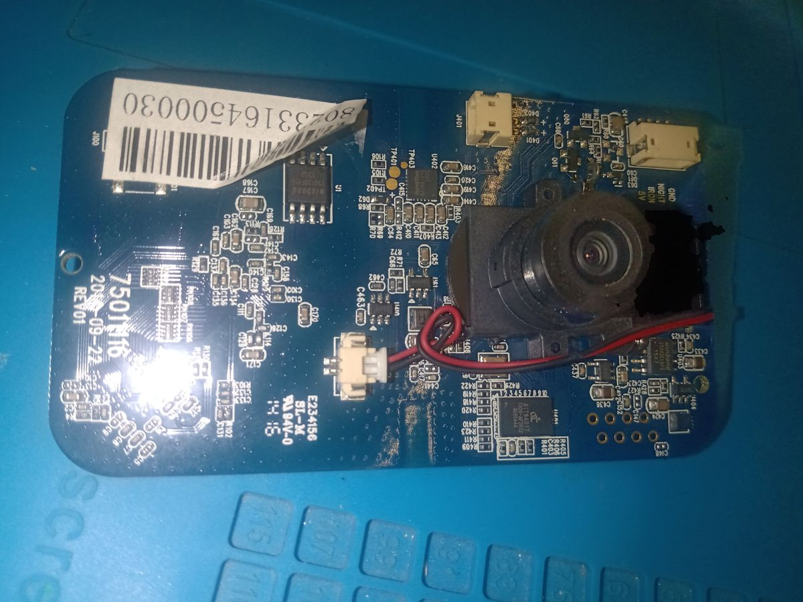
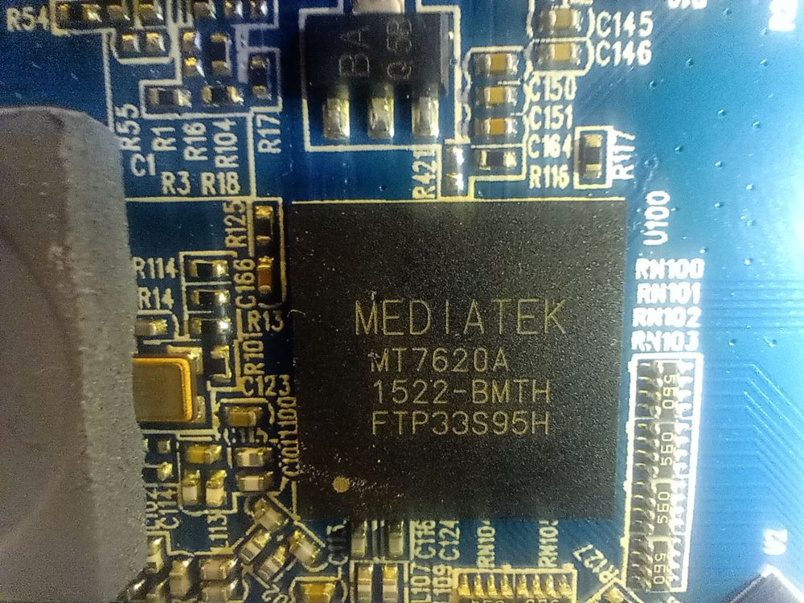
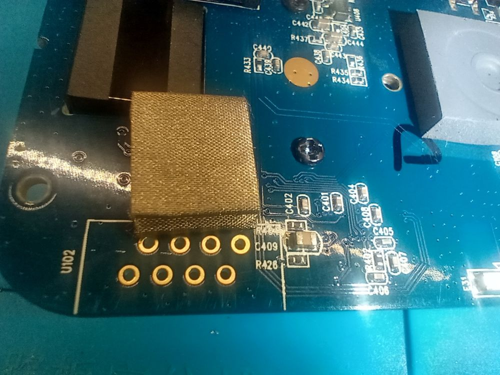

# Cámara Kodak CFH-V10 — recuperación total (sin nube)

Reverse engineering de hardware, firmware y red para **revivir una cámara IP
que quedó inutilizable cuando el fabricante cerró su nube**. El resultado: la
cámara vuelve a dar video en vivo, **sin depender de ningún servicio de
terceros** y bajo control propio — de hecho, con la salida a internet
bloqueada por completo.

> Caso completo (con más contexto y fotos): **https://www.fs-dev-tech.ar/proyectos/**



---

## El problema

La cámara (rebrand de una Belkin WeMo NetCam / Seedonk) solo emite video hacia
la nube del fabricante. Cuando ese servicio se dio de baja, el firmware de
fábrica quedó inservible: sin ese servidor, la cámara no expone el video por
ningún lado. La marca no ofrece alternativa.

La única salida real: entenderla por dentro y **reemplazar su cerebro**.

## El equipo

| | |
|---|---|
| **SoC** | MediaTek/Ralink **MT7620A** (MIPS 24Kc, little-endian, soft-float) |
| **RAM** | 128 MB DDR2 |
| **Flash** | Winbond 16 MB SPI (W25Q128) |
| **Sensor** | **AIT8431** UVC (se auto-inicia; expone `/dev/video0`, MJPEG/H264/YUYV) |
| **Kernel** | Linux 2.6.36, uClibc, BusyBox, servidor GoAhead (el cliente de la nube) |

<p>


</p>

## Las fases

1. **Volcado de flash.** Desoldé la flash SPI a un adaptador y volqué los 16 MB
   con un programador CH341A, con varias pasadas para verificar integridad.
2. **Reversing del firmware.** Mapa de particiones (U-Boot, NVRAM, EEPROM de
   fábrica, dos kernels). Cada kernel es un `uImage` LZMA con un `initramfs`
   (cpio + XZ) embebido.
3. **Acceso root.** U-Boot no interrumpible y password de root incrackeable →
   acceso por **UART** (57600 8N1, 3.3 V) y, finalmente, reflasheo de un
   firmware modificado con binarios propios inyectados en el cpio.
4. **Streamer de video propio.** [`src/mjpgstream.c`](src/mjpgstream.c): servidor
   MJPEG-over-HTTP sobre V4L2, en C, cross-compilado estático para mipsel.
   Reemplaza por completo la dependencia de la nube.
5. **Aislamiento.** Se deshabilita todo el stack de la nube en el arranque
   (`AutoRunApp=NO` en NVRAM). El AP propio queda cerrado (WPA2 + SSID oculto) y
   una ACL en el gateway le bloquea **toda** salida a internet.
6. **Acceso remoto.** [go2rtc](https://github.com/AlexxIT/go2rtc) transcodifica
   MJPEG→H264/WebRTC y lo publica por un túnel cifrado, detrás de
   autenticación.

## El bug que costó horas (V4L2 + musl)

El streamer daba `EINVAL` en `QUERYBUF`/`QBUF`/`DQBUF`. Causa: **musl usa
`time_t` de 64 bits**, lo que cambia `sizeof(struct v4l2_buffer)`. Como los
números de ioctl de V4L2 se codifican con `_IOWR(..., sizeof(struct))`, un
struct del tamaño "moderno" genera un número de ioctl distinto y el kernel
2.6.36 lo rechaza.

**Solución:** definir el buffer con la ABI exacta del kernel (`timeval` de 32
bits, `sizeof == 68`) y armar los ioctl a mano con ese struct:

```c
struct kbuf {                 /* sizeof == 68, no el del musl moderno */
    unsigned int index; int type; unsigned int bytesused, flags;
    int field, tv_sec, tv_usec; unsigned char timecode[16];
    unsigned int sequence; int memory;
    unsigned int m, length, input, reserved;
};
#define K_DQBUF _IOWR('V', 17, struct kbuf)
```

Detalle completo en [`src/mjpgstream.c`](src/mjpgstream.c).

## Compilar

```sh
pip install ziglang          # zig cc como cross-toolchain
cd src && sh build.sh        # -> mjpgstream (mipsel, static, ~64 KB)
```

## Arquitectura final

```
Cámara IP  (firmware propio, streamer MJPEG auto-arranque)
   |   IP privada :8080  —  salida a internet BLOQUEADA por ACL
   v
Servidor Linux  -->  go2rtc  : MJPEG -> H264 / WebRTC
   |
   v
nginx (auth)  -->  túnel cifrado  -->  acceso remoto con login
```

## Sobre la IA en el proceso

Todo el proyecto se resolvió en tándem con IA (Claude) como copiloto de
ingeniería: identificar formatos de firmware a partir de los volcados,
desarrollar el streamer y cazar el bug de `musl`/ioctl, cross-compilar y hacer
la cirugía byte a byte del cpio, y diagnosticar la red. No reemplaza el trabajo
de banco (soldadura, UART, programador) — pero comprime de semanas a horas las
partes de análisis y desarrollo.

## Nota de seguridad

Este repo **no** incluye volcados de firmware (`*.bin`): esos contienen
secretos específicos del dispositivo (PSK de Wi-Fi, hash de root, MAC/EEPROM de
fábrica). Solo se publica código y notas propias.

---

## Licencia

[MIT](LICENSE) © 2026 Fabián Ernesto Suárez — [fs-dev-tech.ar](https://www.fs-dev-tech.ar)
